<title>Catatan rilis sistem dan situs web | Cara Simera</title>

[Beranda](..) &raquo; [Catatan rilis](.) &raquo; 
# Sistem dan situs web (Terbaru)

<blockquote>

**Daftar isi**

<!-- @import "[TOC]" {cmd="toc" depthFrom=2 depthTo=2} -->
<!-- code_chunk_output -->

- [13 Oktober 2026](#13-oktober-2026)
- [29 September 2026](#29-september-2026)
- [15 September 2026](#15-september-2026)
- [1 September 2026](#1-september-2026)
- [18 Agustus 2026](#18-agustus-2026)
- [4 Agustus 2026](#4-agustus-2026)
- [28 Juli 2026](#28-juli-2026)
- [21 Juli 2026](#21-juli-2026)
- [7 Juli 2026](#7-juli-2026)
- [Yang lebih lama](#yang-lebih-lama)
- [Informasi lebih lanjut](#informasi-lebih-lanjut)

<!-- /code_chunk_output -->

</blockquote>

---

## 13 Oktober 2026

|           | Sistem  | Situs web |
| --------- |:-------:|:---------:|
| **Versi** |`1097703`|`d2f6075`  |

### Perubahan

**Peningkatan fitur:**
1. Di laporan acara bagian rincian grafik, aktivitas terkini sekarang dipecah menjadi dua:
   1. Periodik
      
      Ini adalah aktivitas terkini yang sudah ada. Jumlah yang ditampilkan adalah yang hanya terjadi pada menit tersebut, sehinga grafiknya bisa naik, mendatar, maupun turun. Bisa digunakan untuk mengetahui kapan aktivitas mulai meningkat atau melandai.
   2. Kumulatif
      
      Ini adalah aktivitas terkini yang baru. Jumlah yang ditampilkan adalah gabungan dari awal hingga menit tersebut, sehingga grafiknya hanya bisa naik atau mendatar. Bisa digunakan untuk mengetahui kapan kode terproses sudah mencapai 25, 50%, atau 75%.
2. Di entri kode penukaran dan siapkan kode pintu, pengguna akan diberikan informasi saat panjang kode yang dimasukkan melebihi batas 
3. Di entri kode penukaran dan jual kode pintu, pilihan jumlah kolom info tambahan ditingkatkan menjadi 5 mengikuti jumlah lampiran
4. Di pengurusan kode penukaran, kode penukaran dapat dihubungkan kembali maupun diputus hubungannya dengan kode pintu. Ini menyelesaikan masalah sebelumnya di mana kode penukaran lupa dihubungkan saat penukaran dan sudah hilang dari riwayat, maupun kode penukaran masih terhubung meskipun penukarannya telah dibatalkan.
5. Di sinkronisasi data, data rehat kode pintu (waktu pakai keluar dan masuk kembali), serta pantauan kode penukaran sekarang (kabar per saluran) dapat dipulihkan ke sistem lokal
6. Perubahan gaya bawaan jika sistem berjalan pada URL dengan akhiran ".lan" dan ".offline"
7. Pelacakan jumlah hit dan ukuran data per sesi pengguna untuk analisis serangan
8. Optimasi pengurutan kolom tabel untuk tipe data teks, waktu, dan angka dengan memindah JavaScript dari inline ke eksternal

**Perbaikan bug:**
1. Di judul tab, judul dari halaman yang sedang dibuka gagal ditampilkan di samping nama acara jika nama acara mengandung tanda petik
2. Di pengurusan kode penukaran, nomor pesanan tidak bisa diurutkan
3. Di pengurusan kode penukaran, nomor kursi dan nama pembeli tidak bisa ditelusuri

_Tidak ada halaman baru di rilis ini._

### Tangkapan layar

- _Peningkatan fitur #1_
   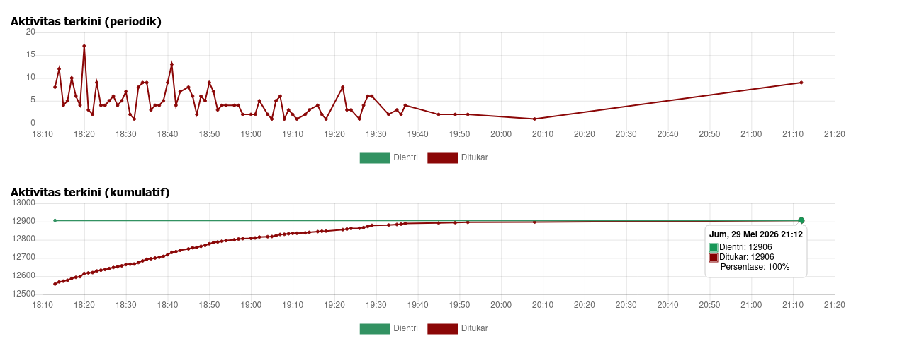
- _Peningkatan fitur #4 - Hubungkan_
   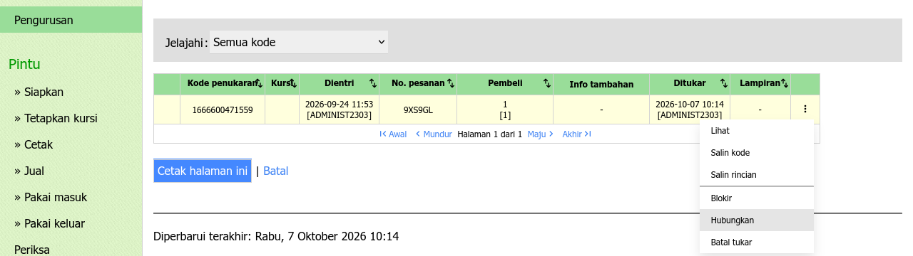
- _Peningkatan fitur #4 - Putus-hubungkan_
   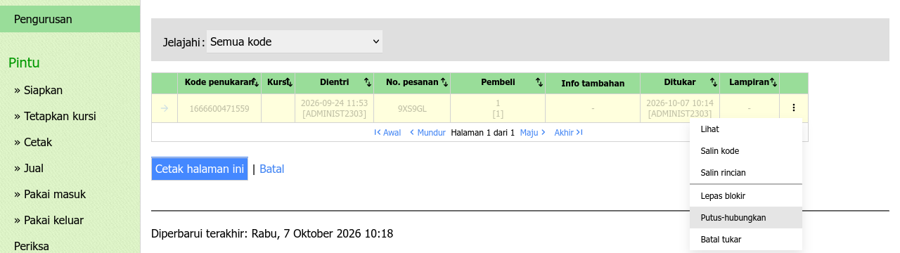
- _Peningkatan fitur #7_
   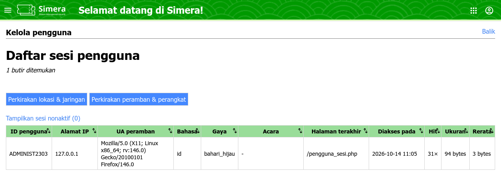

---

## 29 September 2026

|           | Sistem  | Situs web |
| --------- |:-------:|:---------:|
| **Versi** |`e2a55e3`|`d2f6075`  |

### Perubahan

**Halaman baru:**
1. Halaman pengurusan kode penukaran. Fungsi daftar lengkap kode penukaran sekarang berada di halaman ini. Dengan perubahan dan penambahan fitur sbb:
   1. Beranda
      
      Ini adalah fitur baru di mana tindakan terhadap kode penukaran dapat dipilih. Di antaranya adalah: telusuri, unduh, jelajahi, dan buat undian. Ini menyelesaikan masalah sebelumnya di mana filter tidak dapat dilakukan saat jumlah kode penukaran yang dientri terlalu banyak, karena sistem harus menunggu seluruh kode selesai diambil terlebih dahulu.
   2. Telusuri
      
      Ini adalah pengganti fitur filter dari halaman daftar lengkap kode penukaran terdahulu. Fitur ini sekarang dilengkapi dengan pilihan untuk memindai lewat kamera maupun NFC agar lebih nyaman digunakan pada laptop tanpa alat scanner. Selain itu, fitur ini akan selalu mengambil data terbaru ketika penelusuran dilakukan. Ini menyelesaikan masalah sebelumnya di mana data yang ditampilkan setelah filter mungkin usang, karena data hanya diambil sekali saat memuat halaman di awal dan tidak diambil ulang saat filter dilakukan ataupun diubah.
   3. Unduh semua ke CSV
      
      Ini adalah fitur dengan nama yang sama dari halaman daftar lengkap kode penukaran terdahulu. Fitur ini sekarang dilengkapi dengan pilihan untuk mengunduh dengan kolom hanya berisi kode dan nomor kursinya saja (misal untuk keperluan percetakan), ataupun dengan baris hanya berisi kode yang terhubung ke kode pintu (misal untuk keperluan pelacakan).
   4. Jelajahi (bagian dari Lain-lain)
      
      Ini adalah pengganti fitur utama dari halaman daftar lengkap kode penukaran terdahulu. Fitur ini sekarang dilengkapi dengan pilihan untuk mengurutkan tabel berdasarkan kolom tertentu, dan tindakan tambahan di ujung kolom untuk: lihat (kode QR), salin kode, salin rincian (kode beserta kategori, kursi, penyalur, dan nomor pesanan), blokir/lepas blokir, tukar/hubungkan, dan batal tukar/hapus. Pilihan tindakan yang tersedia akan mengikuti kondisi dari masing-masing kode penukaran.
   5. Lain-lain
      
      Fitur buat undian dari halaman daftar lengkap kode penukaran terdahulu sekarang berada di bagian ini. Tidak ada perubahan di sini.

**Peningkatan fitur:**
1. Di menu samping, link halaman yang ditampilkan hanya yang berkaitan dengan pengarsipan jika pengarsipan kode lama sebelum revamp sedang dibuka
2. Di temukan kode penukaran, tukar kode penukaran, dan hapus data, pilihan penyalur sekarang diurutkan berdasarkan abjad
3. Di daftar lengkap kode penukaran, sekarang bisa menampilkan kode yang dihubungkan ke kode pintu saja ataupun sebaliknya
4. Di sinkronisasi data, pengguna yang menyiapkan, mencetak, menjual, dan memakai masuk/keluar kode pintu, serta mengentri dan menukar kode penukaran akan diatur ke pengguna yang melakukan pemulihan data ke sistem lokal karena ada perbedaan urutan pengguna pada data

**Perbaikan bug:**
1. Di pengurusan kode pintu, nama pembeli dengan 5 huruf atau kurang tidak bisa ditelusuri
2. Di daftar lengkap kode penukaran, pilihan kategori tidak menampilkan jumlah kode sesuai penyalur yang sedang dipilih (efek peningkatan fitur #3 rilis [1 September 2026](#1-september-2026))

### Tangkapan layar

- _Halaman baru #1 - Beranda_
   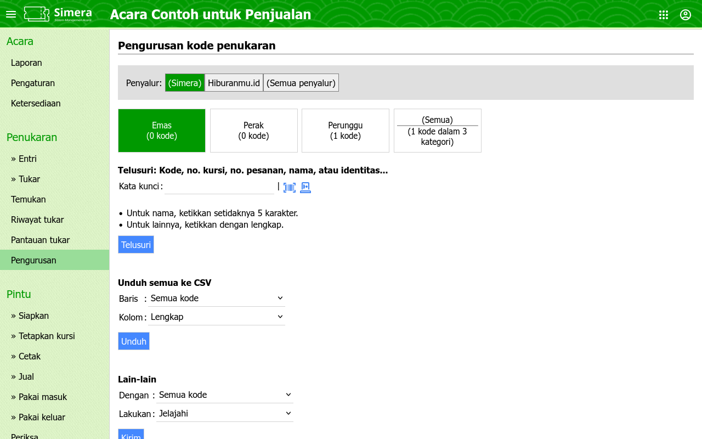
- _Halaman baru #1 - Jelajahi_
   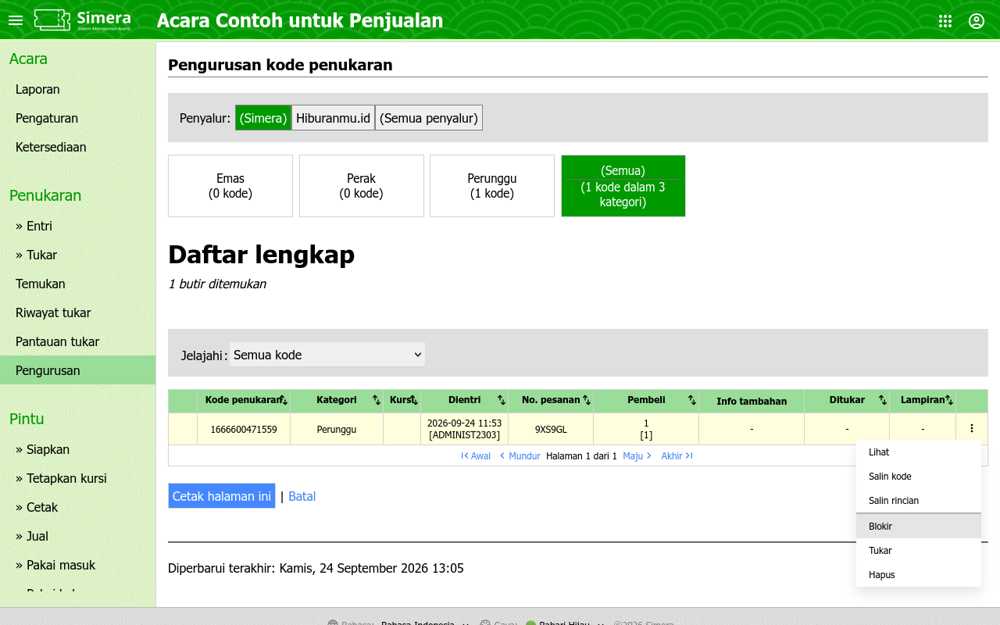
- _Peningkatan fitur #3_
   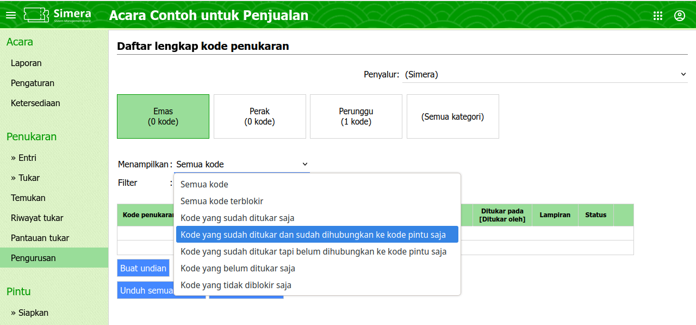

---

## 15 September 2026

|           | Sistem  | Situs web |
| --------- |:-------:|:---------:|
| **Versi** |`b605c76`|`d2f6075`  |

### Perubahan

**Halaman baru:**
1. Halaman pengurusan kode pintu. Fungsi daftar lengkap kode pintu sekarang berada di halaman ini. Dengan perubahan dan penambahan fitur sbb:
   1. Beranda
      
      Ini adalah fitur baru di mana tindakan terhadap kode pintu dapat dipilih. Di antaranya adalah: telusuri, unduh, jelajahi, dan tindakan lain seperti buat undian atau paksa pakai keluar. Ini menyelesaikan masalah sebelumnya di mana filter tidak dapat dilakukan saat jumlah kode pintu yang disiapkan terlalu banyak, karena sistem harus menunggu seluruh kode selesai diambil terlebih dahulu.
   2. Telusuri
      
      Ini adalah pengganti fitur filter dari halaman daftar lengkap kode pintu terdahulu. Fitur ini sekarang dilengkapi dengan pilihan untuk memindai lewat kamera maupun NFC agar lebih nyaman digunakan pada laptop tanpa alat scanner. Selain itu, fitur ini akan selalu mengambil data terbaru ketika penelusuran dilakukan. Ini menyelesaikan masalah sebelumnya di mana data yang ditampilkan setelah filter mungkin usang, karena data hanya diambil sekali saat memuat halaman di awal dan tidak diambil ulang saat filter dilakukan ataupun diubah.
   3. Unduh semua ke CSV
      
      Ini adalah fitur dengan nama yang sama dari halaman daftar lengkap kode pintu terdahulu. Fitur ini sekarang dilengkapi dengan pilihan untuk mengunduh dengan kolom hanya berisi kode dan nomor kursinya saja (misal untuk keperluan percetakan), ataupun dengan baris hanya berisi kode yang diblokir (misal untuk keperluan pelacakan).
   4. Jelajahi (bagian dari Lain-lain)
      
      Ini adalah pengganti fitur utama dari halaman daftar lengkap kode pintu terdahulu. Fitur ini sekarang dilengkapi dengan pilihan untuk mengurutkan tabel berdasarkan kolom tertentu, dan tindakan tambahan di ujung kolom untuk: lihat (kode QR), salin kode, salin rincian (kode beserta kategori dan kursi), blokir/lepas blokir, pakai masuk/pakai keluar, dan batal pakai/hapus. Pilihan tindakan yang tersedia akan mengikuti kondisi dari masing-masing kode pintu.
   5. Lain-lain
      
      Fitur buat undian dan paksa pakai keluar dari halaman daftar lengkap kode pintu terdahulu sekarang berada di bagian ini. Tidak ada perubahan di sini.

**Peningkatan fitur:**
1. Di judul tab, judul dari halaman yang sedang dibuka akan ditampilkan di samping nama acara untuk mempermudah navigasi pada browser
2. Di menu samping, tampilan otomatis bergeser ke link halaman yang sedang dibuka sehingga akan tetap terlihat meski ada di urutan bawah
3. Di daftar lengkap kode penukaran dan kode pintu, sekarang bisa menampilkan kode yang diblokir saja ataupun sebaliknya

**Perbaikan bug:**
1. Di kelola tempat (pilihan negara), kelola penyimpanan (pilihan jenis lampiran dan log), dan hapus data (jenis data), tidak bisa dinavigasi menggunakan keyboard
2. Di entri kode penukaran dan siapkan kode pintu, pilihan kategori tidak bisa dinavigasi menggunakan keyboard

### Tangkapan layar

- _Halaman baru #1 - Beranda_
   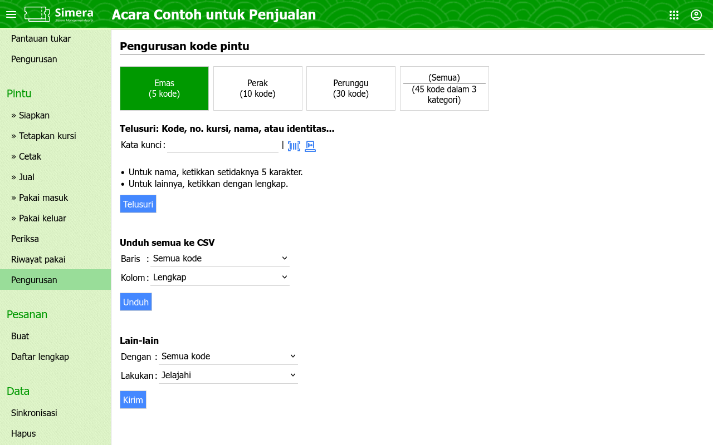
- _Halaman baru #1 - Jelajahi_
   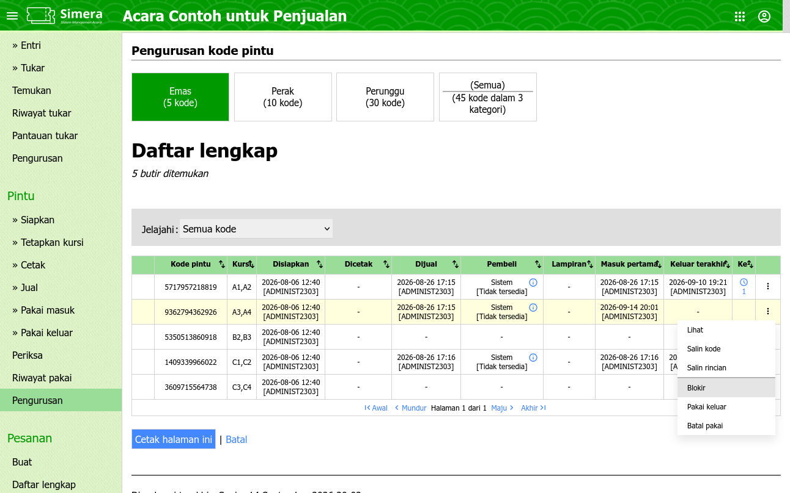
- _Peningkatan fitur #1_
   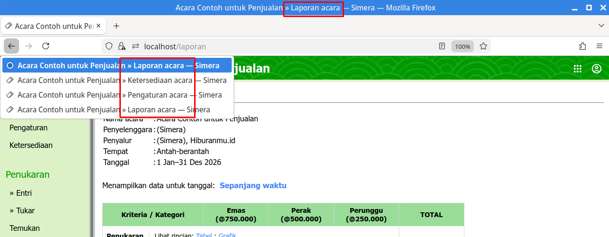
- _Peningkatan fitur #3_
   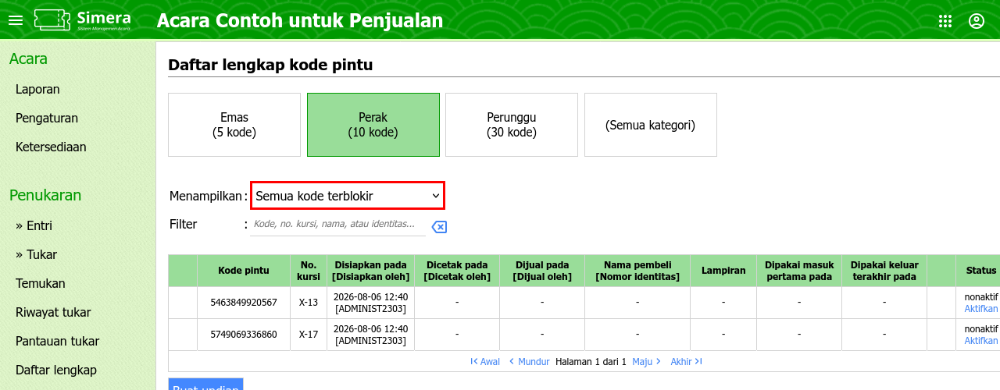

---

## 1 September 2026

|           | Sistem  | Situs web |
| --------- |:-------:|:---------:|
| **Versi** |`7027bf8`|`d2f6075`  |

### Perubahan

**Peningkatan fitur:**
1. Di kelola pengguna, daftar pengguna dapat diurutkan menurut terakhir masuk
2. Di pakai masuk/keluar kode pintu, halaman siap menerima kode yang dikirim dari halaman lain (mengikuti tukar kode penukaran yang menerima kode dari halaman temukan)
3. Di daftar lengkap kode penukaran, buat undian sekarang sudah bisa dilakukan (mengikuti daftar lengkap kode pintu)
4. Di sinkronisasi data, data kode pintu dari sistem lokal bisa dicadangkan dengan format seluler untuk dipulihkan ke sistem online

**Perbaikan bug:**
1. Di entri kode penukaran, saat dijalankan di lokal, hanya baris pertama yang dapat dientri lalu muncul kotak peringatan (efek peningkatan fitur #1 rilis [18 Agustus 2026](#18-agustus-2026))
2. Di cetak pesanan, kirim tautan dan log akses berhenti befungsi (efek peningkatan fitur #4 rilis [8 Juni 2026](./utama_2026H1#8-juni-2026))
3. Di menu-menu kelola, kolom dengan angka yang sama muncul lebih dari satu kali pada tabel tidak dapat diurutkan

_Tidak ada halaman baru di rilis ini._

---

## 18 Agustus 2026

|           | Sistem  | Situs web |
| --------- |:-------:|:---------:|
| **Versi** |`1fbfae0`|`d2f6075`  |

### Perubahan

**Peningkatan fitur:**
1. Di entri kode penukaran dan siapkan kode pintu, log kueri dinonaktifkan agar tidak memenuhi penyimpanan
2. Di kelola acara, proyek acara dapat dibuka/ditutup/dialihkan (tergantung acara yang sedang dibuka) dan halaman penjualan di situs web dapat dibuka secara langsung saat sedang melihat rincian acara
3. Di beranda, sekarang acara yang sedang dibuka proyeknya dapat diubah dengan mengeklik tombol "Ubah"
4. Di judul tab dan header, tersedia indikator tambahan jika mengakses lingkungan uji coba
5. Tersedia indikator tambahan pada log kueri sistem jika berasal dari lingkungan uji coba
6. [Situs web] Pemisahan ketergantungan dengan sistem utama agar mendukung konfigurasi server baru (keperluan migrasi)

**Perbaikan bug:**
1. Nama acara di header tidak otomatis berubah setelah mengubah nama acara yang sedang dibuka proyeknya

_Tidak ada halaman baru di rilis ini._

### Tangkapan layar

- _Peningkatan fitur #2_
   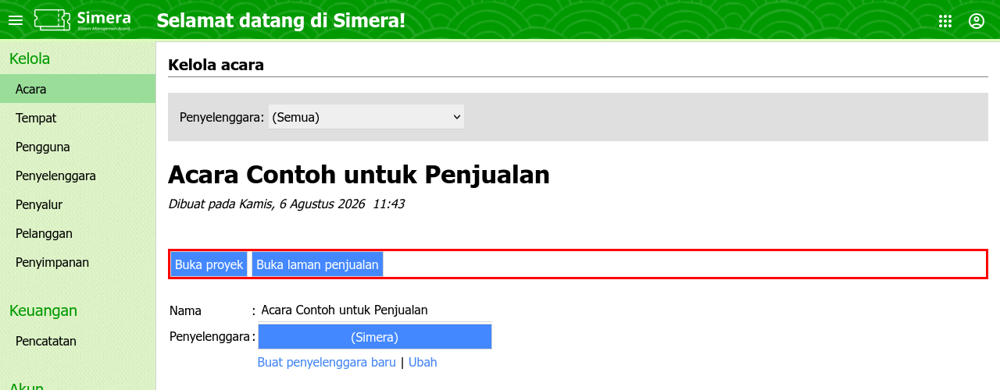
- _Peningkatan fitur #4_
   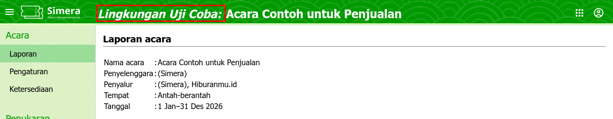

---

## 4 Agustus 2026

|           | Sistem  | Situs web |
| --------- |:-------:|:---------:|
| **Versi** |`e3e3d29`|`eed1ac0`  |

### Perubahan

**Peningkatan fitur:**
1. Di daftar lengkap kode pintu, informasi jumlah pakai dipindah dari kolom "status" ke "durasi".

   Informasi jumlah pakai (dan durasi) akan muncul tanpa memedulikan status kode pintu, asalkan sudah pernah dipakai keluar. Dulu, jumlah pakai tidak muncul jika statusnya adalah diblokir. Sekarang, informasi status menjadi jelas karena tidak akan berubah menjadi jumlah pakai lagi jika statusnya adalah aktif.
2. Optimasi kueri saat hapus kategori di pengaturan acara
3. Optimasi rendering menu di header dengan memindah JavaScript dari inline ke eksternal

**Perbaikan bug:**
1. Di daftar kode pintu, durasi gagal ditampilkan saat diklik (efek peningkatan fitur #4 rilis [8 Juni 2026](./utama_2026H1#8-juni-2026))
2. Di entri kode penukaran dan jual kode pintu, kotak teks tidak dapat diisi dan ketikan muncul di panel pemindai kode (efek rilis 30 Desember 2024)
3. Tampilan kamera tidak muncul setelah dibuka untuk kedua kalinya dan seterusnya saat menambah lampiran menggunakan kamera (khusus Chrome)

_Tidak ada halaman baru di rilis ini._

### Tangkapan layar

- _Peningkatan fitur #1_
   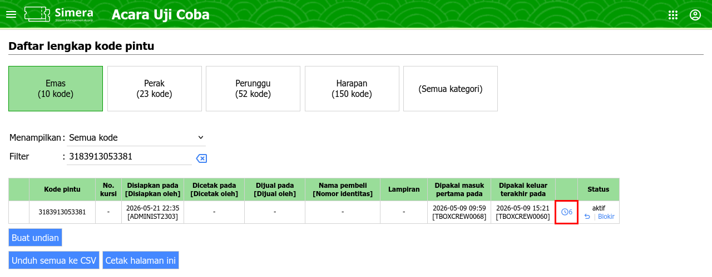

---

## 28 Juli 2026

|           | Sistem  | Situs web |
| --------- |:-------:|:---------:|
| **Versi** |`eaef779`|`eed1ac0`  |

### Perubahan

**Peningkatan fitur:**
1. Pengarsipan kode lama sebelum revamp (lanjutan). API lama dipisahkan dari API yang digunakan saat ini.
2. Penyesuaian fungsi remot ke peladen lokal karena ada perubahan di sisi pihak ketiga
3. Penyesuaian kamera yang digunakan untuk memindai dan menambah lampiran jika perangkat memiliki banyak kamera
4. Optimasi kueri di perhitungan jumlah kode penukaran dan kode pintu per kategori

**Perbaikan bug:**
1. Muncul kotak peringatan saat menambah lampiran menggunakan kamera (efek peningkatan fitur #3 rilis [7 Juli 2026](#7-juli-2026))

_Tidak ada halaman baru di rilis ini._

---

## 21 Juli 2026

|           | Sistem  | Situs web |
| --------- |:-------:|:---------:|
| **Versi** |`eb8facc`|`eed1ac0`  |

### Perubahan

**Peningkatan fitur:**
1. Pengarsipan kode lama sebelum revamp. Versi lama dari beranda, menu kelola acara, kelola pengguna, entri kode penukaran, dan siapkan kode pintu bisa diakses dengan URL khusus.

**Perbaikan bug:**
1. Muncul kotak peringatan terus menerus saat pemindai kamera tidak menemukan kode QR atau barcode (efek peningkatan fitur #3 rilis [7 Juli 2026](#7-juli-2026))

_Tidak ada halaman baru di rilis ini._

---

## 7 Juli 2026

|           | Sistem  | Situs web |
| --------- |:-------:|:---------:|
| **Versi** |`ecdafd2`|`eed1ac0`  |

### Perubahan

**Peningkatan fitur:**
1. Revamp entri kode penukaran
   
   Informasi nama penyalur yang aktif kini ditampilkan. Berpindah penyalur dan kategori sekarang tidak memerlukan muat ulang halaman sehingga menjadi lebih cepat.
2. Implementasi model voucer untuk buat/perbarui/hapus data di entri kode penukaran, bayar pesanan, dan hapus data
3. Optimasi pemindaian kamera dan NFC serta opsi layar penuh di semua halaman dengan memindah JavaScript dari inline ke eksternal
4. Optimasi foto via kamera dan unggah berkas di semua halaman dengan memindah JavaScript dari inline ke eksternal

_Tidak ada halaman baru dan perbaikan bug di rilis ini._

---

## Yang lebih lama

- [2026 H1](./utama_2026H1)

---

## Informasi lebih lanjut

Silakan buka diskusi di grup "System Update", atau hubungi William Surya Permana.

---

_Akhir dari dokumen_ &#x7C; [Kembali ke atas](#)
